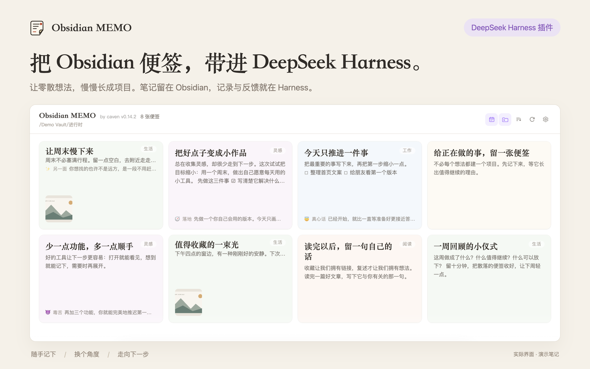
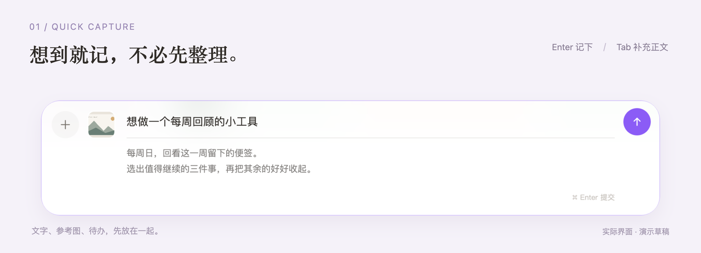
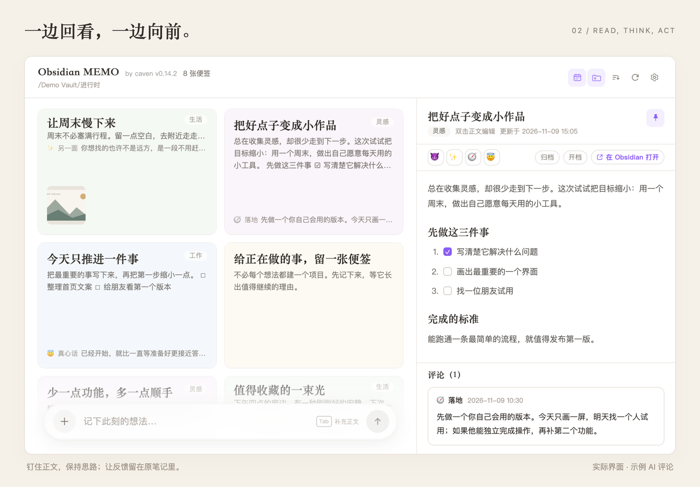

# dsh-obsidian-memo

**An Obsidian notes plugin for DeepSeek Harness.**

Capture thoughts, revisit them, and let AI move an idea forward — while every note stays a plain Markdown file in your Obsidian vault.

Harness sidebar panel · local Markdown · uses your default model · one-click project draft

[What it is](#what-it-is) · [Install](#install) · [Usage](#usage) · [Data & privacy](#data--privacy) · [FAQ](#faq) · [简体中文](README.md)

 [](LICENSE)  [](https://github.com/cavenzhong/dsh-obsidian-memo/stargazers)

## What it is

While working with AI in DeepSeek Harness, some thoughts are worth keeping but don't deserve a project yet.

dsh-obsidian-memo adds a notes entry to the Harness sidebar and turns one of your Obsidian folders into a pastel sticky-note wall. Jot down a thought, a reference image, or something you're working through; when you want a second opinion, use Harness's default model to look at it from another angle.

**Capture → revisit → get feedback → open a project / archive it**

There is no second notebook: each sticky note is a `.md` file in the folder you choose, images are vault attachments, and archiving simply moves the file.

**A good fit if**

- Your notes already live in Obsidian and you want to capture new thoughts while working.
- You don't want a project for every idea, but want to expand one when it matters.
- You're happy to let AI weigh in, as long as notes stay local Markdown.

**Probably not for you if**

- You want a replacement for Obsidian's search, backlinks, and plugin ecosystem.
- You need the full wall experience on a phone (this is desktop-first).

## Highlights

- **See what's on your mind at a glance.** Subfolders get stable colors; filter by date, sort by created or modified time; light and dark themes are both covered.
- **Capture text and images together.** A bottom composer takes notes anytime; paste, drag in, or pick multiple images, compressed to WebP by default.
- **Read and edit in place.** Click a card to read, double-click to edit Markdown; pin the right-hand panel to tidy up while keeping the wall in view, and tick off tasks directly.
- **From one line to the next step.** Four AI personas offer a different angle; "Open project" drafts a structured project document and links it back to the note.
- **Notes still belong to Obsidian.** Existing frontmatter is preserved and nothing is imported or migrated; apart from model calls you explicitly trigger, the plugin does not go online, and it keeps no separate API key.

## A closer look

### Capture: the title is the filename



Type a line and press `Enter` to create a note. Press `Tab` to expand the body and `⌘ / Ctrl + Enter` to submit. Paste or drag images straight into the composer; the title becomes the Markdown filename, and the body, images, and later comments all live in the same note.

### Revisit: text, tasks, and AI comments together



The right panel shows the full note, collapsible comments, and checkable tasks. Pin it to work side by side with the wall; drag its edge to resize, and the body and comments scroll independently. The line above the comments is also draggable to adjust how much space comments get, and the collapsed/expanded state is remembered. Cards show only each comment's emoji + label + count; click a card to read, add, or delete comments (the source Markdown is updated too, with a 5-second undo).

## Install

**Requirements**

- **DeepSeek Harness** `0.2.2-rc.1` or a later `0.2.x` (developed and verified on `0.2.2-rc.1`; the desktop app and Web GUI use the same channel).
- A local **Obsidian vault**. The plugin reads and writes that folder directly and does not require an Obsidian community plugin.
- No build step and no runtime dependencies; you do not need Node, pnpm, or a separate API key.

**1. Install from npm**

Open the DSH Plugins page, choose Add plugin, and enter `dsh-obsidian-memo`. You can also ask the Harness agent to use `plugin_manager`:

```text
action: install_bundle
target: dsh-obsidian-memo
```

Open the notes entry in the Harness sidebar. If you previously installed a local `link:` copy, remove that entry first; the npm package `dsh-sticky-notes` belongs to someone else and is unrelated.

**Local development**

```bash
git clone https://github.com/cavenzhong/dsh-obsidian-memo.git
```

Install with `target: link:/absolute/path/to/dsh-obsidian-memo` for development or preview. A `link:` install uses the local directory and does not provide npm version checks.

**2. Pick folders and start writing**

Open the top-right gear or Settings → Plugins → Obsidian MEMO. Settings are grouped into Folders, AI, Images, and Manage & about. Choose the vault once; other folders use one shared dropdown with creation, browsing, search, and recent selections. AI personas use horizontal emoji tabs with an add button.

| Setting | Required | Notes |
| --- | --- | --- |
| Vault root | Yes | Your Obsidian vault, e.g. `~/Documents/MyVault`. |
| Notes folder | Yes | The folder you want on the wall, e.g. `Inbox`. |
| Project folder | For projects | Where generated project documents are stored. |
| Archive folders | No | Add several; the archive button lists these targets. |
| Image folder | No | Defaults to `_attachments/` inside the notes folder; must be inside the vault and not a dot-hidden folder. |
| Image processing | No | WebP compression is on by default: quality 70, max edge 2048px. Adjustable or off. |
| AI personas & budget | No | Four comment personas, prompts, callout style, and token budget (default "high"). |

All folders must live in the same Obsidian vault. Notes from subfolders are included by default and can be toggled in the header.

Configuration defaults to `~/.config/dsh-obsidian-memo/config.json` (Windows: `%APPDATA%/dsh-obsidian-memo/config.json`; honors `XDG_CONFIG_HOME`). Legacy `data/settings.json` is migrated once and kept. Load config opens a native JSON file chooser and loads the selected file immediately; cancelling keeps the current configuration. Open config, Load config, and More use equal-width buttons; More contains Open file, Reload, and Save copy & use. Manage & about ends with a small, muted GitHub text link and `by cavenzhong` on one line. External edits load automatically; malformed files are preserved. `DSH_STICKY_NOTES_SETTINGS` still pins a location.

**Update, disable, uninstall**

- **Update:** npm installs can check and apply updates from the DSH Plugins page. The manager checks the npm package version. For a `link:` install, run `git pull` and repeat the local install command.
- **Disable:** switch it off on the Plugins page; notes and settings stay put.
- **Uninstall:** remove the plugin on the Plugins page. With a `link:` install the source folder is not deleted, and independent user configuration is also retained; find its location in Manage & about and remove it manually if desired; **notes and attachments in Obsidian are untouched**.

## Usage

### Quick capture

The floating composer sits below the wall. Type an idea as the new `.md` filename and press `Enter`; the title is not duplicated into the body. Press `Tab` to expand the body; clearing it collapses the composer again. A failed submit (duplicate name, overly long filename) keeps your draft and images.

Paste, drag, or use the plus button to attach up to 8 images. They are compressed to static WebP by default; keep originals and animation in settings. New notes reuse the frontmatter of the Obsidian Default Template configured for the current folder.

### Read, edit, and tidy

- Click a card to open the reading panel; double-click the title or body to edit, and press `⌘ / Ctrl + S` to save.
- Cards keep the normal arrow cursor. Folder tags overlay the upper-right corner over a matching paper-color gradient; cards and the reader share paper-colored tags with darker matching text and adjusted contrast in dark mode.
- The reader's action bar is one row: Archive, To project, Delete, and Copy full note on the left, in that order, with line icons and tooltips above; the purple icon-and-text Open in Obsidian button sits on the right. AI comment emojis live in the comments heading row at the bottom, beside the Comments title. The double-click editing hint appears only when the body is empty.
- Card comments are grouped by emoji + label, showing only a bold count and no body text; click a card to open it. In the reader, drag the line above the comments to resize them (96px to 72%, double-click to reset), or click the heading arrow or Comments title to collapse them into one row.
- Each comment has a delete button; deleting removes the callout from the source Markdown and offers a 5-second undo. If the file changed again meanwhile, the undo is refused.
- Saves are version-checked. If Obsidian, an AI comment, or another edit changed the note meanwhile, the save is refused and your draft is kept.
- Tick tasks in reading mode; they are written back as `[ ]` / `[x]` while preserving line breaks and frontmatter.
- Click the pin to keep the panel open on the right; re-entering restores the last note.
- Header controls switch the date range, include/exclude subfolders, and sort by created time, modified time, or filename.

### Four AI perspectives

Click an emoji on a card to ask Harness's current default model about that note. Prompts, callout style, and token budget are configurable.

| Perspective | What you get |
| --- | --- |
| 😈 Sharp | Punctures self-persuasion with one useful, clear-eyed line. |
| ✨ Other side | Reconsiders the note from an angle you hadn't tried. |
| 🧭 Practical | A judgment, the evidence behind it, and the cheapest next step. |
| 😇 Honest | Meets where you are and offers one piece of pressure-free encouragement. |

Comments are appended to the Markdown as Obsidian callouts, so they remain readable in Obsidian. If the same emoji already has a comment, the plugin asks before adding another.

### Organize, copy and delete

The drag preview has a soft shadow, with its action hint centered above it. The archive folder menu sits above the Archive zone with a subtle shadow. Releasing over the main zone parks the preview at its center and temporarily hides the icon and label. Click a folder to archive; clicking outside, moving focus outside, losing window focus, or pressing Esc returns the card. Enter returns it and focuses capture.

Dragging a card replaces capture with Archive / To project / Delete. Archive reveals the configured archive folders, To project opens the project name dialog, and Delete acts on release. An empty dashed outline remains at the original position. The preview follows the pointer at one third of the card's width and height, with an opaque action tag above it on a higher layer. The dock gradient changes with the target while staying clear of the reader panel. Below the AI comment controls, the card menu only contains Copy and Open in Obsidian.
Pointer movement updates only the preview layer, and switching the dock keeps the layout stable. Cancelling animates the card back; archive and delete fade it out and keep the placeholder until the operation completes, preventing a brief flash of the original card. Reduced-motion preferences skip these animations.

- **Copy:** use the button on a card or in the reader to copy the filename title on its own line followed by the full Markdown body, without frontmatter, with a success message.
- **Delete:** click the reader's muted warning-colored Delete icon, drop on Delete, or press `⌘ / Ctrl + Backspace` on a card or in the reader. The note and its exclusive local images move together to `.trash/MEMO-…` inside the vault, with a 5-second undo. Shared images stay in place. After expiry, files remain available for manual recovery using the original paths in `restore.json`; nothing is automatically purged. Existing trash files are preserved. In macOS Finder, press `⌘ + Shift + .` to show hidden folders.
- **Back to top:** a round ↑ button appears above capture after scrolling past one screen.

### To project, archive, open in Obsidian

- **Open project:** enter a project name; AI creates `<name>/<name>.md` in the project folder with needs, current state, findings, next steps, and open questions, then writes the link back to the source note's `PROJECTS` field.
- **Archive:** moves the Markdown file to the chosen archive folder, with a 6-second undo.
- **Open in Obsidian:** the host opens `obsidian://open?path=<absolute note path>`. Only existing files inside the vault are allowed, and nothing is written.

### Shortcuts

| Action | Shortcut |
| --- | --- |
| Create note | `Enter` in the title field |
| Focus / blur capture | `Enter` (except while typing in capture or editing the reader body) / `Esc` within capture |
| Expand / collapse body | `Tab` in title / `Backspace` or blur with an empty body |
| Delete note | `⌘ / Ctrl + Backspace` on a card or in the reader |
| Submit note | `⌘ / Ctrl + Enter` |
| Back from body to title | `Shift + Tab` |
| Save edit | `⌘ / Ctrl + S` |
| Read / edit | Click a card / double-click title or body |
| Open date-range menu | Hover the calendar icon, or focus it and press `↓` |
| Close menu / panel | `Esc` |

## Data & privacy

- **Notes and images stay in your vault, including deleted files in its `.trash` folder.** The plugin reads and writes the Obsidian folder you choose; it does not import, copy, or maintain a second library.
- **Settings live in an independent user `config.json`, with a customizable location.** The official settings page and panel share this file; no config is written to your Obsidian vault.
- **No separate API key.** AI uses Harness's current default model and is called only when you click a comment or Open project; it does not start a conversation or write chat logs.
- **No telemetry.** The plugin makes no analytics or tracking calls. Remote images inside notes are loaded by the browser, as with any Markdown file.
- **Model calls send the relevant note content to your configured model provider.** That content is the input for the requested comment or project document and is limited to the current note.
- **File boundaries are enforced.** Note, archive, project, and image paths must stay inside the vault; the image folder cannot be a dot-hidden folder; existing files are written atomically and new notes never overwrite a same-name file.
- **Frontmatter is preserved.** Only "Open project" touches frontmatter, updating `PROJECTS`, and an existing non-empty value is never overwritten.
- **Concurrent edits are guarded by a version check.** There is no cross-process file lock; an external write in the very short window between check and write can still race.

## Compatibility & limits

| Item | Notes |
| --- | --- |
| DeepSeek Harness | `>=0.2.2-rc.1 <0.3.0` (`engines.dsh`); developed and verified on 0.2.2-rc.1. |
| Runtime | DSH desktop app or Web GUI. Verified on macOS; Windows/Linux path and open logic is implemented but untested. |
| Obsidian | A local vault, iCloud is fine. No Obsidian community plugin required. |
| Themes | Follows the DSH light and dark themes. |
| Scale | The wall renders 50 notes first and loads more on scroll; hundreds of notes remain usable. |
| Not included | Full-text search, drag-and-drop ordering, batch actions, a dedicated mobile layout, and real-time file watching (external changes are picked up by a 4–30 second poll). |

- Local images support PNG / JPEG / GIF / WebP / SVG / AVIF, up to 8 MB each; card thumbnails only load images up to 1.5 MB (larger ones still open in the reading panel).
- Quick capture accepts up to 8 images: 32 MB each / 64 MB total before compression, 8 MB each / 16 MB total after.
- AI input is capped at 12,000 characters; comments at 4,000 and project documents at 24,000; truncation is reported.
- The plugin is desktop-first; touch devices are not specifically adapted, and the date-range menu has limitations there.

## FAQ

**The notes entry is missing from the sidebar.**

Make sure the plugin is installed and enabled, then restart or refresh DSH. Also check whether the old package name (`dsh-sticky-notes`) is still installed — remove it before installing this one.

**The panel opens but the wall is empty.**

Check the vault root and notes folder in settings, whether the date filter is on and excludes your notes (click the calendar icon to turn it off), whether subfolders are hidden, and whether the folder actually contains `.md` files.

**No AI comment appears.**

Confirm that DSH has a default model configured. If the model spends its whole budget on reasoning, the plugin shows a hint and points you to the budget setting; a shorter prompt can help too. Provider or network errors are reported in a toast.

**It says the filename is duplicated or saving failed.**

The title is the Markdown filename, so names must be unique in the folder. Choose another title or handle the existing file; the draft and selected images are kept on failure and cleared only after success.

**"Open in Obsidian" does nothing.**

Obsidian must be installed and the `obsidian://` protocol registered; only existing files inside the vault can be opened. Otherwise a failure toast is shown and no files are changed.

**Will it damage my notes?**

It won't restructure them: editing replaces only the body after frontmatter, comments are appended at the end, and Open project only updates `PROJECTS`. Obsidian block IDs are hidden in the plugin's display but kept in the file. If an external edit happened meanwhile, the save is refused by the version check.

**Does uninstalling delete my notes?**

No. Notes and attachments remain in your Obsidian vault. Uninstalling removes only the plugin registration; with a `link:` install the source folder, independent user config, and pre-migration `data/settings.json` remain and can be cleaned up manually.

**Is this an official Obsidian plugin?**

No. It is a third-party DeepSeek Harness plugin, not affiliated with DeepSeek or Obsidian, and it does not require an Obsidian community plugin; it only reads and writes the local vault you choose.

## Feedback & contributing

- Found a bug or want different behavior? Open an [issue](https://github.com/cavenzhong/dsh-obsidian-memo/issues). Please include the DSH version, plugin version, OS, Obsidian version, steps to reproduce, expected and actual results, and screenshots or logs if possible.
- Pull requests are welcome. The plugin is plain JavaScript with no runtime dependencies. Browser sources are modular; run `pnpm build` and `pnpm test`, and mention the results in the PR.
- Known issues and deferred items are tracked in [docs/KNOWN_ISSUES.md](docs/KNOWN_ISSUES.md); search it before filing.

## Development

```bash
cd dsh-obsidian-memo
pnpm install --frozen-lockfile
pnpm build       # src/client/ → lib/client.js
pnpm test        # generated output, architecture checks and regression tests
pnpm dev         # optional: watch browser sources alongside Harness HMR
```

To release, update the version in `package.json` and both README badges, add an entry to `docs/CHANGELOG.md`, and push to `main`. GitHub Actions tests and packs one `.tgz`, publishes that exact file to npm ([`dsh-obsidian-memo`](https://www.npmjs.com/package/dsh-obsidian-memo)), and attaches it to the GitHub Release. The npm package contains runtime files, browser sources and build scripts, locales, the bundle patch, and documentation; tests and internal agent instructions are excluded. npm publishing uses Trusted Publishing (OIDC, no stored token), bound to GitHub Actions with `npm trust github --file release.yml --repo cavenzhong/dsh-obsidian-memo --allow-publish`; if the binding is revoked or expires, run that command again (account 2FA) and push a new version within 48 hours to validate it. The workflow independently skips an npm version or GitHub Release that already exists, so a failed side can be retried. Ordinary commits do not create releases.

| Path | Contents |
| --- | --- |
| `lib/index.js` / `lib/host/` | Host entry, focused services and RPC transport. |
| `src/client/` | Browser sources grouped by data, wall, reader, settings, images and dragging. |
| `lib/client.js` | Generated browser bundle; installation requires no build. |
| `lib/capture.js` / `lib/notes.js` | Note and attachment creation, Markdown parsing and writing. |
| `lib/settings.js` / `lib/scan.js` | Settings, folder scanning and caches. |
| `lib/ai.js` / `lib/obsidian.js` | Model calls and the system opener. |
| `test/` / `test-support/` | Focused suites and shared test harnesses. |
| `docs/` | Guide, implementation contract, changelog, known issues. |

Version 0.16.3 separated Host services, browser interactions and large test suites. Start with the [architecture map](docs/ARCHITECTURE.md) and the [repository development guide](https://github.com/cavenzhong/dsh-obsidian-memo/blob/main/AGENTS.md) to locate each feature and its tests. The [0.16 performance review](docs/AUDIT-0.16.md) retains the earlier audit findings (Chinese).

See the [usage and development guide](docs/GUIDE.md) (Chinese) for full behavior and the HMR workflow, and the [implementation contract](docs/CONTRACT.md) for API and UX specifications.

## Credits & license

Thanks to [DeepSeek Harness](https://github.com/deepseek-ai/deepseek-harness) for its open plugin APIs, and to [Obsidian](https://obsidian.md) for keeping notes as local Markdown.

Released under the [MIT](LICENSE) license, © cavenzhong. This is a third-party plugin with no affiliation to DeepSeek or Obsidian; their names and marks belong to their respective owners.
