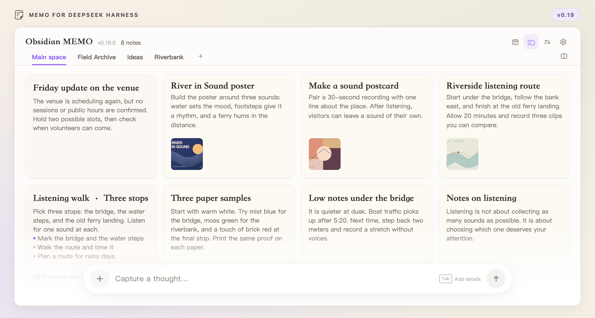
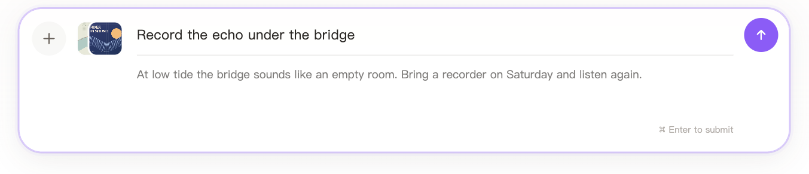
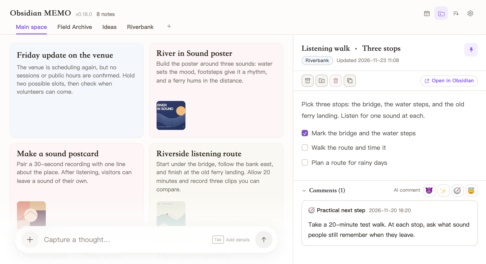
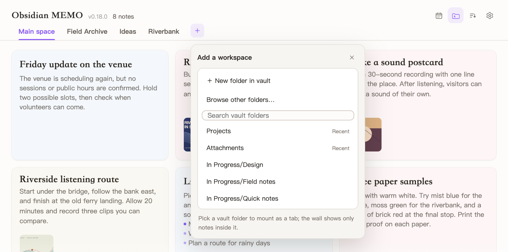
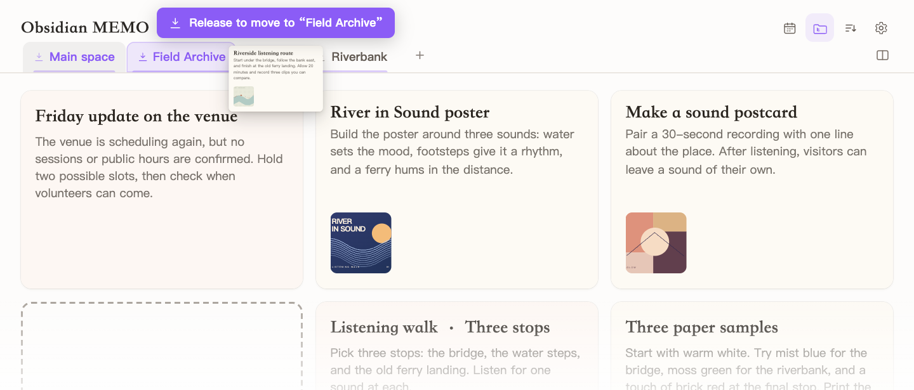
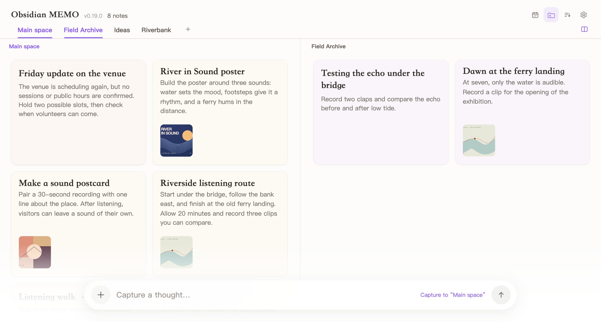
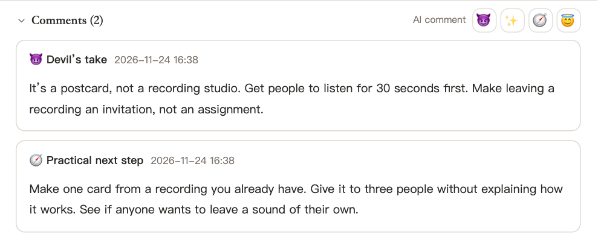
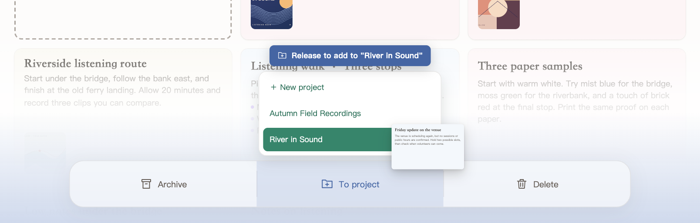
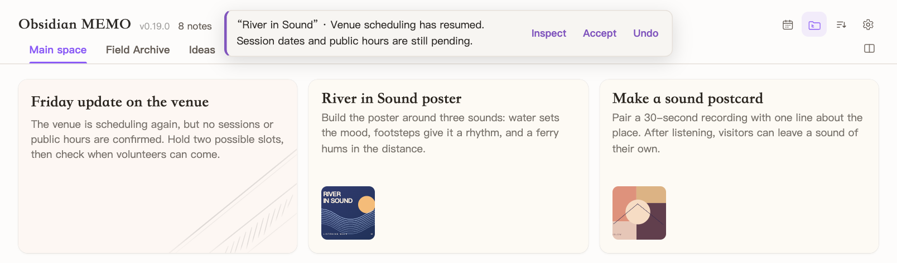

<p align="center">
  
</p>

<h1 align="center">DSH Obsidian MEMO</h1>

<p align="center"><strong>Read and edit Obsidian notes on a sticky-note wall inside DeepSeek Harness.</strong></p>

<p align="center">Jot down an idea, paste a picture, or get AI feedback in Harness. Then pick up where you left off in Obsidian.<br>Both work with the same local Markdown files. No imports or migration.</p>

<p align="center">
  
  <a href="https://www.npmjs.com/package/dsh-obsidian-memo"></a>
  <a href="LICENSE"></a>
</p>

<p align="center">
  <a href="#install"><ins>Install</ins></a> ·
  <a href="#everyday-use"><ins>Everyday use</ins></a> ·
  <a href="#workspaces"><ins>Workspaces</ins></a> ·
  <a href="#dual-view"><ins>Dual view</ins></a> ·
  <a href="#ai-comments-four-perspectives"><ins>AI comments</ins></a> ·
  <a href="#send-to-deepseek"><ins>Send to DeepSeek</ins></a> ·
  <a href="#from-note-to-project"><ins>From note to project</ins></a> ·
  <a href="#faq"><ins>FAQ</ins></a> ·
  <a href="README.md"><ins>简体中文</ins></a>
</p>



**Fixed in 0.19.1:** Moves, archives, and renames now use the Obsidian CLI by default to keep links within the vault working. Settings checks the CLI and link-update setting. For a plain Markdown folder, choose Folder management instead. [See what changed (中文)](docs/CHANGELOG.md).

## Install

You need **DeepSeek Harness 0.2.2-rc.1 or a later 0.2.x version** and a local Obsidian vault or Markdown folder that Harness can access. No companion plugin in Obsidian is needed.

1. In Harness, go to **Plugins → Add Plugin**, enter `dsh-obsidian-memo`, then install and enable it. Confirm the version is **0.19.1** or later on the Plugins page.
2. If DSH asks you to restart, restart once. Then open the sticky notes panel in the sidebar. Under **Settings → Folders**, select your **vault folder** and **default workspace** (Main space). If you do not use Obsidian, choose Folder management.
3. Type a thought in the capture bar at the bottom and press `Enter` to save your first note. To track projects, also select a **Project index folder**.

You can also ask an agent to install it:

```text
action: install_bundle
target: dsh-obsidian-memo
```

`dsh-sticky-notes` on npm is a different DSH notes plugin and is unrelated to this one. Updates and uninstalling happen on the Plugins page; uninstalling only removes the plugin registration and never deletes your notes.

## Everyday use

### Capture a thought and paste in an image

In the capture bar, press `Enter` to save a title, `Tab` to add a body, or `⌘ / Ctrl + Enter` to submit text and images. Paste or drag in images; they’re compressed to WebP by default.



### Browse on the left, work on a note on the right

Each note uses the color of its deepest mounted workspace. Changing a parent workspace does not override a child workspace listed in the workspace bar; changing the child also updates its cards, tag backgrounds, and reader capsules when shown in the parent view. Subfolders without their own workspace inherit the nearest mounted parent color. Workspace tabs themselves keep a clean neutral background. Use the calendar in the header to filter by date. Open a card and pin the reader to browse and check off tasks side by side. Double-click the title or body to edit, and select multiple list items, then press `Cmd/Ctrl+L` to cycle their bullet or task markers in bulk. Opening a card smoothly brings it to the first row of its wall and briefly outlines it for reference. Select **Open in Obsidian** to keep writing there.



### Preserve internal links when moving notes

The **File operation engine** is above the vault picker in **Settings → Folders**. The default, **Obsidian CLI**, lets Obsidian update internal links when DSH moves a note between workspaces, archives it, or renames it. This includes references in vault folders you have not mounted in DSH. Enable the Obsidian **Command line interface** under **Settings → General** and **Automatically update internal links** under **Settings → Files and links**.

If the CLI is unavailable, DSH explains why and does not move the note automatically. You can choose **Folder management** and save the setting if you manage a plain Markdown folder or prefer not to use the CLI. Direct moves do not update references: links can break or start pointing to another note with the same name. Reading, editing note content, and creating notes do not require the CLI. To register an existing or empty folder, select **Open as a vault in Obsidian…**, complete setup in Obsidian, enable link updates, then return and select Recheck.

### Archive notes without deleting them

Under **Settings → Notes → Note archiving**, choose **In each note folder** (the default, which moves the note into an archive subfolder of its current folder) or **Chosen folder, keep structure**. Drag a card onto **Archive** or use the reader’s archive button. The note disappears from the active wall, and you have 6 seconds to undo the move. Older archive targets aren’t carried over; select an archive folder again if you want to keep using a specific location.

## Workspaces

The tabs under the header let you switch between folders without changing settings. **Main space** is the **default workspace** and stays first. Click **+** to add another visible folder from the vault, including folders outside the default workspace. You can’t add the vault root, the default workspace itself, or a folder that already has a tab.

A custom tab shows notes in its folder and subfolders. The **Include subfolders** toggle affects only Main space. Adding a tab doesn’t move any files; removing it leaves the folder and its notes in place.



- **Capture:** New notes are saved directly in the selected tab’s folder.
- **Move:** Drag a card onto the destination tab to move its Markdown file. Duplicate filenames get a numeric suffix. You have 6 seconds to undo the move from the notification.
- **Organize tabs:** Drag a custom tab sideways to reorder it. On a touchscreen, press and hold first. Use **…** to see all tabs when they don’t fit. Right-click any tab to choose one of nine paper colors. You can also remove custom tabs and undo the removal within 5 seconds.
- **View side by side:** Use the split-view icon at the far right of the tab bar or press `Cmd+;` to toggle split view. When split view is on, two workspaces appear side by side. Selecting a third workspace replaces only the focused pane. Turning split view off keeps only the current workspace. Hold Cmd to see `⌘1–⌘9` next to the first nine workspace tabs and the `⌘;` lock/unlock hint next to the split-view icon. Drag the divider to resize and click either pane to make it the quick-capture destination.



*In this example, the card is headed to **Field Archive**, a folder outside Main space. The same file move is visible in Obsidian.*

## Dual view

Keep two workspaces side by side: collect ideas on the left and review tasks or reference notes on the right, without repeatedly switching tabs. Add at least one custom workspace, then click the split-view icon at the far right of the tab bar, or press `Cmd+;`, to turn dual view on or off.



- **Switch the focused side:** Click either wall to focus it; choosing a third workspace replaces only that side. The other workspace stays in place, and new notes go to the focused workspace.
- **Browse independently:** Each wall scrolls and loads more notes independently. Drag the divider to resize them, or double-click it to restore equal widths; the view state and width ratio are saved locally for this vault.
- **Use the keyboard:** Hold `Cmd` to see the first nine tabs’ `⌘1–⌘9` shortcuts and the split-view `⌘;` hint. These shortcuts do not interrupt text entry. Turning dual view off keeps the focused workspace.

## AI comments: Four perspectives

No need to paste a note into chat. Open it and pick an emoji in the comments panel. AI leaves a comment from that perspective at the end of the original note, where you can also read it in Obsidian. With no comments yet, the section stays collapsed, but the emoji buttons are still available.

| Perspective | When to use it |
| --- | --- |
| 😈 **Devil’s take** (毒舌) | Use sharp humor to call out what you’re missing. |
| ✨ **Another angle** (另一面) | Get unstuck with an angle you hadn’t considered. |
| 🧭 **Practical next step** (落地) | Find one concrete step and a way to tell if it worked. |
| 😇 **Honest encouragement** (真心话) | See what you’re already doing right and find an easy place to start. |



*Two takes on the same audio-postcard idea: keep it simple, or test a rough version with three listeners.*

Customize the four presets under **Settings → AI**.

## Send to DeepSeek

When reading a long answer inside the note wall is not ideal, send the note to a new DeepSeek conversation in DSH. Entry points are the reader action bar (after copy), the card hover menu, and the drag action bar; selecting text inside the plugin and right-clicking also offers copy and send-selected-text.

- By default a shared picker opens: choose **Title + content** or **MD attachment**, then the default workspace or an existing DSH workspace. The page jumps to the new conversation with the content in the composer; press Enter to send.
- **Title + content** puts the title in the first paragraph and appends the body without the `.md` name; **MD attachment** uploads an `.md` copy with comment callouts removed; the message text carries the title.
- Check **Do not show the picker** under **Settings → Notes → Send to DeepSeek** (after Note title) to send directly to the configured workspace and format.

Title + content sends the title and body; MD attachment sends the title and an `.md` copy with comment callouts removed (frontmatter and other content are preserved). Sending selected text sends only that text. Existing AI comments are not included and the note is never modified.

## From note to project 

> Project features are still being tested and may change substantially in future releases.

Drag a note to **To project** to start a project or add an update to an existing one. The note stays where it is and gets an Obsidian link back to the project.



*Drag over To project to see new and existing project options. After choosing an existing project, you have 3 seconds to cancel by default.*

As you add notes, AI revises the **current overview** and appends one entry to the **progress log**. Read the overview to see where things stand; read the log to see how they got there. Old entries and standalone level-two sections such as “My notes” stay intact.



*Review the change summary after it’s written. If it’s not right, choose Undo before accepting to restore both the project and the source note. This undo is no longer available after restarting Harness.*

[See a project document example (中文)](docs/GUIDE.md#项目文档怎么读怎么补充).

## FAQ

**How do I change the interface language?** Go to **Settings → Manage & about → Interface language** and choose Follow Harness (default), 简体中文, or English. The change takes effect immediately in this client and does not change your notes or AI prompts.

**Missing the sidebar entry, or seeing an empty wall?** Make sure the plugin is enabled and restart DSH if it asks you to — the desktop app usually needs one restart before the sidebar entry appears. If the wall is empty, check for `.md` files in the selected workspace and try turning off the date filter. If notes in Main space are in subfolders, enable **Include subfolders**. To show a folder outside Main space, add it with **+**.

**Do I need a separate AI key? What if generation fails?** No. Comments use the Harness default model. Projects can use a different one under **Settings → AI → Project AI**. If generation fails, check your model setup and use the panel message to decide whether to retry or adjust the output budget.

**Do updates or uninstalling touch my notes?** Updates follow the npm version on the Plugins page; uninstalling only removes the plugin registration, and your notes and images stay in the vault.

**Which systems are supported?** Developed and verified on macOS. The path and “Open in Obsidian” code also covers Windows and Linux but is untested there. There’s no mobile-specific layout; it’s desktop-first.

**Are my notes uploaded?** Notes and images stay in the local vault. The plugin has no telemetry. Only when you use AI comments or project features are the relevant note and any needed project content sent to your configured model provider.

**What if I delete a note by accident?** It goes to the vault’s `.trash`, not straight to permanent deletion. Undo from the notification while it’s visible, or recover the note from the vault’s trash later.

**Do workspaces sync across devices?** No. Tabs, single/dual-view state, and pane widths are local view preferences for this Harness profile (keyed by vault path); they are not written to the vault or the settings JSON. Re-add them on another device or after clearing app data; your notes are unaffected.

---

[Detailed guide (中文)](docs/GUIDE.md) · [Changelog (中文)](docs/CHANGELOG.md) · [Development (中文)](docs/ARCHITECTURE.md) · [Known issues (中文)](docs/KNOWN_ISSUES.md) · [Report an issue](https://github.com/cavenzhong/dsh-obsidian-memo/issues) · [MIT license](LICENSE)
