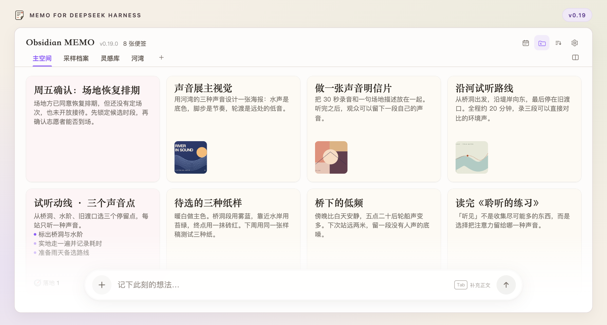
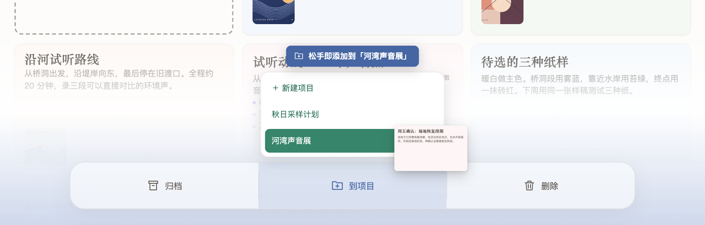
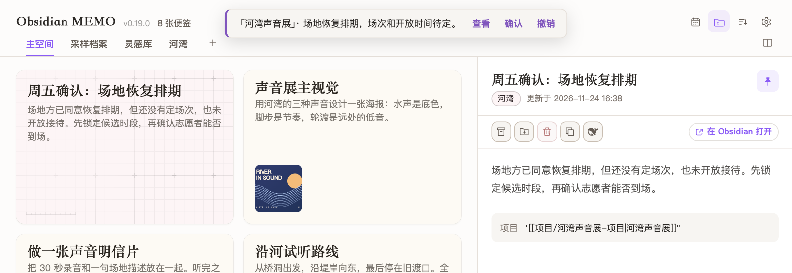
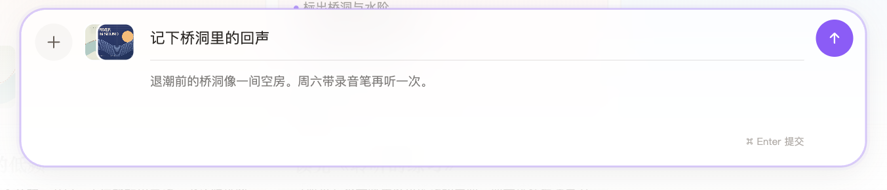
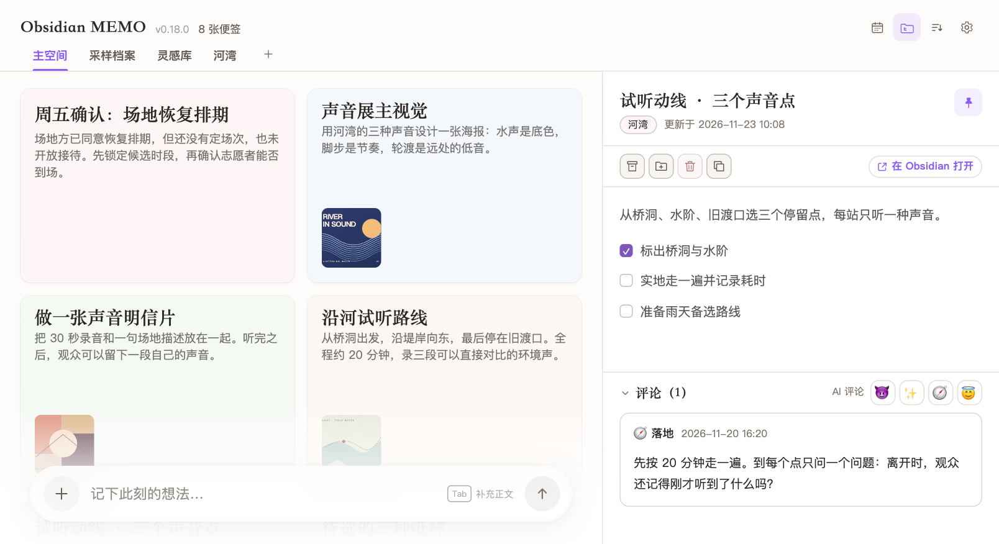

# Obsidian MEMO

`dsh-obsidian-memo` · an Obsidian sticky-note wall for DeepSeek Harness

**Capture as you work. Drag the ideas worth pursuing into a project. Your notes stay in your vault as Markdown.**

 [](https://www.npmjs.com/package/dsh-obsidian-memo) [](LICENSE) · [简体中文](README.md)

[Install](#install) · [From note to project](#from-note-to-project) · [Everyday use](#everyday-use) · [FAQ](#faq)



- **Capture in place** — `Enter` saves a title, `Tab` adds a body, `⌘ / Ctrl + Enter` submits text and images. Paste or drag images in; they’re compressed to WebP by default.
- **See everything, work on one** — notes are color-coded by subfolder and filterable by date. Open a card and pin the reader to tick off tasks side by side.
- **A second opinion when you’re stuck** — four emoji personas reuse Harness’s default model and write back as an Obsidian callout.
- **Turn a note into a project** — drag it to **To project**; AI revises the current overview and appends a progress entry. The note stays put and gains one link.
- **Notes still belong to Obsidian** — nothing is imported or migrated; only the folders you pick are read and written, frontmatter preserved.

> **Data boundary:** apart from the AI comments and project updates you trigger, the plugin makes no network requests of its own and stores no API key.

It is not an Obsidian replacement: no full-text search, backlinks, or plugin ecosystem, and no mobile-specific layout yet.

## Install

You need **DeepSeek Harness 0.2.2-rc.1 or a later 0.2.x version** and a local Obsidian vault that Harness can access. No companion plugin in Obsidian is needed.

1. In Harness, go to **Plugins → Add Plugin**, enter `dsh-obsidian-memo`, then install and enable it. Confirm the version is **0.17.0** or later on the Plugins page.
2. If DSH asks you to restart, restart once. Then open the sticky notes panel in the sidebar. Under **Settings → Folders**, select your **Obsidian vault** and **Notes folder**.
3. Type a thought and press `Enter` to save your first note. To track projects, also select a **Project index folder**.

You can also ask an agent to install it:

```text
action: install_bundle
target: dsh-obsidian-memo
```

`dsh-sticky-notes` on npm is a different DSH notes plugin and is unrelated to this one. Updates and uninstalling happen on the Plugins page; uninstalling only removes the plugin registration and never deletes your notes.

## From note to project

Drag a note to **To project** to start a project or add an update to an existing one. The note stays where it is and gets an Obsidian link back to the project.



*Dropping on To project lists new and existing projects; an update waits 3 seconds and can be cancelled.*

As you add notes, AI revises the **current overview** and appends one entry to the **progress log**. Read the overview to see where things stand; read the log to see how they got there. Old entries and standalone level-two sections such as “My notes” stay intact.



*Review the change summary after it’s written. If it’s not right, choose Undo before accepting to restore both the project and the source note. This undo is no longer available after restarting Harness.*

[See a project document example (中文)](docs/GUIDE.md#项目文档怎么读怎么补充).

## Everyday use

### Capture a thought and paste in an image

In the capture bar, press `Enter` to save a title, `Tab` to add a body, or `⌘ / Ctrl + Enter` to submit text and images. Paste or drag in images; they’re compressed to WebP by default.



### Browse on the left, work on a note on the right

Notes are color-coded by subfolder, and you can filter them by date. Open a card and pin the reader to browse and check off tasks side by side. Double-click the title or body to edit. Need a nudge? Pick an emoji for an AI comment. The 🧭 preset suggests a next step you can try. You can also drag a note to archive it or open it in Obsidian.



## FAQ

**Missing the sidebar entry, or seeing an empty wall?** Make sure the plugin is enabled and restart DSH if it asks you to — the desktop app usually needs one restart before the sidebar entry appears. If the wall is empty, check for `.md` files in your notes folder, turn off the date filter, or enable subfolders if that’s where your notes are.

**Do I need a separate AI key? What if generation fails?** No. Comments use the Harness default model. Projects can use a different one under **Settings → AI → Project AI**. If generation fails, check your model setup and use the panel message to decide whether to retry or adjust the output budget.

**Do updates or uninstalling touch my notes?** Updates follow the npm version on the Plugins page; uninstalling only removes the plugin registration, and your notes and images stay in the vault.

**Which systems are supported?** Developed and verified on macOS. The path and “Open in Obsidian” code also covers Windows and Linux but is untested there. There’s no mobile-specific layout; it’s desktop-first.

**Are my notes uploaded?** Notes and images stay in the local vault. Only when you use AI comments or project features are the relevant note and any needed project content sent to your configured model provider.

**What if I delete a note by accident?** It goes to the vault’s `.trash`, not straight to permanent deletion. Undo from the notification while it’s visible, or recover the note from the vault’s trash later.

---

[Detailed guide (中文)](docs/GUIDE.md) · [Changelog (中文)](docs/CHANGELOG.md) · [Development (中文)](docs/ARCHITECTURE.md) · [Known issues (中文)](docs/KNOWN_ISSUES.md) · [Report an issue](https://github.com/cavenzhong/dsh-obsidian-memo/issues) · [MIT license](LICENSE)
