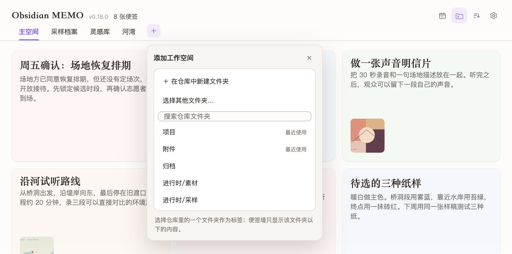
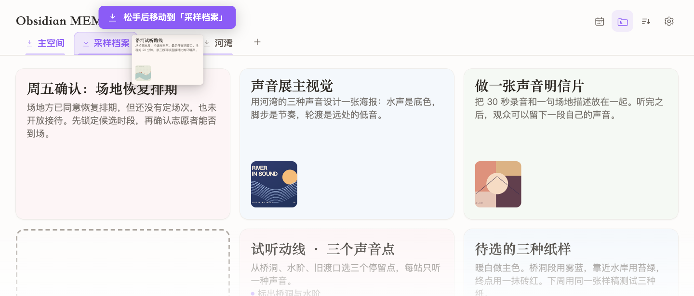
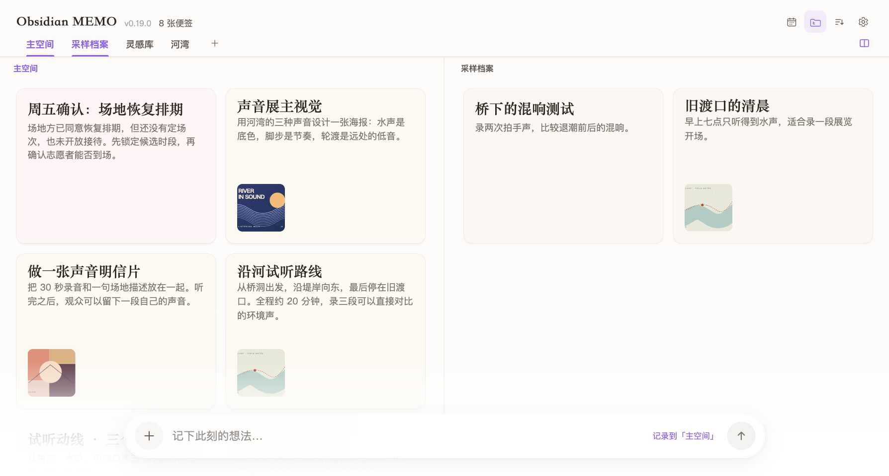

<p align="center">
  
</p>

<h1 align="center">DSH Obsidian MEMO</h1>

<p align="center"><strong>在 DeepSeek Harness 里，用便签墙读写 Obsidian 笔记。</strong></p>

<p align="center">在 Harness 随手记、贴图、请 AI 点评；回 Obsidian 接着整理。<br>两边读写的是同一份本地 Markdown，不用导入，也不用迁移。</p>

<p align="center">
  
  <a href="https://www.npmjs.com/package/dsh-obsidian-memo"></a>
  <a href="LICENSE"></a>
</p>

<p align="center">
  <a href="#安装"><ins>安装</ins></a> ·
  <a href="#日常用法"><ins>日常用法</ins></a> ·
  <a href="#工作空间"><ins>工作空间</ins></a> ·
  <a href="#双视图"><ins>双视图</ins></a> ·
  <a href="#ai-评论四种视角"><ins>AI 评论</ins></a> ·
  <a href="#发送到-deepseek"><ins>发送到 DeepSeek</ins></a> ·
  <a href="#把便签变成项目"><ins>把便签变成项目</ins></a> ·
  <a href="#常见问题"><ins>常见问题</ins></a> ·
  <a href="README.en.md"><ins>English</ins></a>
</p>


**0.19.1 修复：** 移动、归档或改名默认交给 Obsidian CLI 更新同库双链；设置会检查 CLI 和链接更新开关。只管理普通 Markdown 目录？选择「文件夹管理」即可继续使用。[查看版本记录](docs/CHANGELOG.md)。

## 安装

需要 **DeepSeek Harness 0.2.2-rc.1 或更高的 0.2.x 版本**，以及 Harness 能访问的本地 Obsidian 库或 Markdown 文件夹。不用在 Obsidian 里另装插件。

1. 在 Harness 的 **插件 → 添加插件** 中输入 `dsh-obsidian-memo`，安装并启用；装完在插件页确认版本为 **0.19.1** 或更高。
2. 如果 DSH 提示需要重启，重启一次；然后打开左侧栏的便签入口，点右上角 **设置 → 文件夹**，选择 **仓库目录** 和 **默认工作空间**（主空间）。如果不使用 Obsidian，请选择「文件夹管理」。
3. 在底部写一句，按 `Enter` 存下第一张便签。想用项目跟踪？再选一个 **项目索引目录**。

也可以在对话里让 agent 安装：

```text
action: install_bundle
target: dsh-obsidian-memo
```

npm 上的 `dsh-sticky-notes` 是另一款 DSH 便签插件，与本项目无关。更新和卸载都在插件页完成，卸载只移除插件注册，不会删除你的笔记。

## 日常用法

### 想到就记，直接贴图

底部输入栏里，`Enter` 存标题，`Tab` 展开正文，`⌘ / Ctrl + Enter` 提交图文。图片可以直接粘贴或拖进去，默认压缩成 WebP。


### 左边看全局，右边处理一张

纸色按便签所属的最深层已挂载工作空间确定：父空间改色不会覆盖菜单上已有子空间的颜色；子空间改色后，在父空间里显示的该子空间便签、tag 背景和阅读面板胶囊会同步更新。未单独挂载的子文件夹继承父空间颜色。顶栏工作空间标签本身不铺彩色背景。点顶栏的日历可以按日期筛选。点开卡片、钉住右侧面板，就能一边浏览一边勾待办；双击标题或正文可编辑，多选列表项后按 `Cmd/Ctrl+L` 可批量切换圆点、未完成和已完成标记。打开卡片后，便签会缓动到所在墙的第一排并短暂描边，方便对照。点 **在 Obsidian 打开** 可以接着写。


### 移动便签时保护双链

**设置 → 文件夹 → 操作引擎**在仓库选择上方。默认选 **Obsidian CLI**：移动到工作空间、归档或改文件名时，由 Obsidian 更新所属库的内部链接，包括便签墙没挂载的目录。请在 Obsidian 启用 **设置 → 常规 → 命令行界面**，并为该库开启 **设置 → 文件与链接 → 自动更新内部链接**。

CLI 不可用时，DSH 会说明原因，不会自动改用磁盘移动。如果你只管理普通 Markdown 文件夹，或确实不想使用 CLI，可以手动选 **文件夹管理**并保存。直接移动不更新引用：旧链接可能打不开，或指向同名的其他笔记。阅读、正文编辑和新建便签不依赖 CLI。想把普通文件夹或空目录设为库，可点 **在 Obsidian 中设为库…**，在 Obsidian 里完成登记，按提示开启链接更新，再回插件点「重新检查」。

### 归档不等于删除

在 **设置 → 便签 → 归档方式**，可选 **当前目录**（默认移入便签所在目录下的「归档」文件夹），或 **指定目录并保留结构**。把卡片拖到「归档」，或点阅读面板里的归档按钮，便签就会移出活动便签墙，可在 6 秒内撤销。旧版的归档目标不会自动迁移；若要继续归档到指定位置，请在设置中重新选择。

## 工作空间

顶栏第二行是工作空间标签。**主空间**对应设置里的**默认工作空间**，固定在最前。点标签栏的 **＋**，可以把仓库里其他可见文件夹添加成标签，包括默认工作空间之外的文件夹。不能添加仓库根目录、默认工作空间本身，或已有标签的文件夹。

自定义标签展示对应文件夹及其子文件夹的便签；「显示子文件夹」开关只影响主空间。添加标签不会移动文件，移除标签也不会删除文件夹或便签。



- **记到这里：** 在当前标签下快速记录，新便签直接保存在该文件夹。
- **移动便签：** 把卡片拖到目标标签，松手后移动原有 `.md` 文件。遇到同名文件会自动加序号，可在 6 秒内从提示中撤销。
- **整理标签：** 按住自定义标签横拖即可排序，触屏需长按后拖动；放不下时点 **…** 查看全部。右键标签可从 9 种纸色里选色；自定义标签还可用「删除」移除（5 秒内可撤销）。
- **并排查看：** 点标签栏最右侧的分屏图标或按 `Cmd+;` 切换单双屏。图标亮时并排显示两个空间，点第三个标签只替换有焦点的一侧；图标灭时只显示当前一个。按住 Cmd 可看见前九个工作空间标签的 `⌘1–⌘9` 切换快捷键，以及最右侧的「锁定／取消锁定视图 `⌘;`」提示。拖动中间分隔线可调整宽度，点任意一侧可将快速记录切到该空间。



*图中的「采样档案」在主空间之外。移动完成后，Obsidian 里也能在新目录找到这张便签。*

## 双视图

把两个工作空间并排放着：左边收集灵感，右边对照任务或参考资料，不用反复切换标签。先添加至少一个自定义工作空间，再点标签栏最右侧的分屏图标，或按 `Cmd+;`，即可开启或关闭双视图。



- **切换当前侧：** 点任意一侧便签墙取得焦点，再点第三个标签，只替换这一侧，另一侧保持不动；快速记录也会保存到当前侧的工作空间。
- **独立浏览：** 两侧分别滚动、分页加载。拖动中间分隔线调整宽度，双击恢复等宽；单双视图状态与宽度比例按仓库保存在本地。
- **键盘操作：** 按住 `Cmd` 可看见前九个标签的 `⌘1–⌘9` 快捷键与分屏 `⌘;` 提示，输入文字时不抢占快捷键。关闭双视图后，保留当前有焦点的工作空间。

## AI 评论：四种视角

不用把笔记复制到聊天里。打开便签，在评论区点一个 emoji，AI 就会从那个角度留一条评论。评论会追加到原笔记末尾，回 Obsidian 也能看到。还没有评论时，评论区会自动折叠，但仍可点 emoji 发起评论。

| 视角 | 适合什么时候用 |
| --- | --- |
| 😈 **毒舌** | 想听一句不拐弯的，用幽默点破盲点。 |
| ✨ **另一面** | 思路卡住时，从没想过的人或场景看这件事。 |
| 🧭 **落地** | 想知道先做什么，拿到一个可验证的下一步。 |
| 😇 **真心话** | 想要一点支持，看看自己已经做对了什么。 |


*同一个「声音明信片」点子：毒舌提醒别把它做复杂，落地建议先找三个人试听。*

四个预设都可以在 **设置 → AI** 里自定义。

## 发送到 DeepSeek

不想在便签里读长回答时，可以把便签直接送到 DSH 的 DeepSeek 新对话。入口在右侧阅读抽屉（复制按钮之后）、卡片悬停菜单和底部拖拽操作栏；在插件里选中文字后右键，也可以直接复制或发送选中文字。

- 默认弹出共享菜单：先选 **原文 + 标题** 或 **MD 附件**，再选默认工作区或已经打开的 DSH 工作区。页面会跳到新对话，内容先放在输入框，确认后按 Enter 发送。
- **原文 + 标题** 把标题作为第一段，正文接在后面，不带 `.md`；**MD 附件** 上传移除评论 callout 的 `.md` 副本，消息文字只带标题。
- 在 **设置 → 便签 → 发送到 DeepSeek**（便签标题之后）勾选“不弹出选择菜单”后，点击入口会直接发到选定的工作区和形式，不再每次询问。

原文模式发送标题和正文；MD 附件模式发送标题和移除了评论 callout 的 `.md` 副本（保留 frontmatter 与其它正文）。两种都不附现有 AI 评论，原便签和评论都不会被修改。选中文字发送时只发送选中的原文。

## 把便签变成项目 

> 该项目功能仍在测试与推进中，版本推进功能可能会大改。

拖一张便签到 **「到项目」**，可以新建项目，也可以补充到已有项目。源便签留在原处，只多一条指向项目的 Obsidian 双链。


*拖到「到项目」会列出新建和已有项目；选好已有项目后，默认有 3 秒可以取消。*

每次补充，AI 更新 **当前概况**，并在 **进展记录** 末尾追加一条。先看概况就知道现在到哪一步，想追溯再翻历史。旧记录和「我的手记」之类的独立二级章节原样保留。


*写入后先看变更摘要；不合适可以在确认前撤销，项目和源便签一起还原。重启 Harness 后不能再撤销这次更新。*

[看看项目文档示例](docs/GUIDE.md#项目文档怎么读怎么补充)。

## 常见问题

**怎么切换界面语言？** 在 **设置 → 管理与关于 → 界面语言** 选择「跟随 Harness」（默认）、「简体中文」或「English」。切换即时生效，只在当前客户端记住选择，不改动便签或 AI 提示词。

**看不到入口，或便签墙是空的？** 先确认插件已启用，必要时按提示重启 DSH——桌面版通常要重启一次才会出现侧栏入口。墙面为空时，检查当前工作空间里是否有 `.md` 文件，试着关掉日期筛选。如果主空间里的笔记都在子文件夹，打开「显示子文件夹」。要看主空间之外的文件夹，点「＋」添加为工作空间。

**AI 要另配 Key 吗？没生成怎么办？** 不用另配。评论用 Harness 的默认模型，项目可以在 **设置 → AI → 项目 AI** 单独选模型。没生成时，先检查模型配置，再按面板提示重试或调整预算。

**更新、卸载会动我的笔记吗？** 更新在插件页按 npm 版本进行；卸载只移除插件注册，笔记和附件留在仓库里。

**支持哪些系统？** 主要在 macOS 上开发验证；Windows / Linux 的路径与「在 Obsidian 打开」已实现但未实测，移动端没有专门适配，以桌面为主。

**笔记会上传吗？** 笔记和附件留在本地仓库，插件没有遥测。只有你主动使用 AI 评论或项目功能时，相关便签及所需的项目内容才会发给配置的模型服务。

**误删便签怎么办？** 便签移入仓库内的 `.trash`，不是直接永久删除。删除后可以在提示消失前撤回；错过了也可以从库内回收站找回。

**工作空间会同步到别的设备吗？** 不会。标签列表、单双视图状态与分屏宽度都是当前 Harness 配置里的视图偏好（按仓库路径保存在本地），不写进 Obsidian 仓库，也不进设置 JSON；换设备或清理浏览器数据后重新添加即可，笔记本身不受影响。

---

[详细指南](docs/GUIDE.md) · [版本记录](docs/CHANGELOG.md) · [开发导航](docs/ARCHITECTURE.md) · [已知问题](docs/KNOWN_ISSUES.md) · [反馈问题](https://github.com/cavenzhong/dsh-obsidian-memo/issues) · [MIT 许可](LICENSE)
