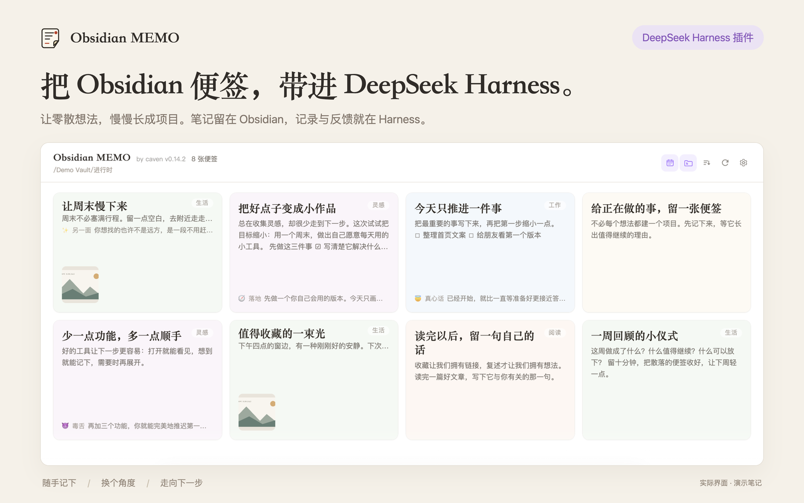
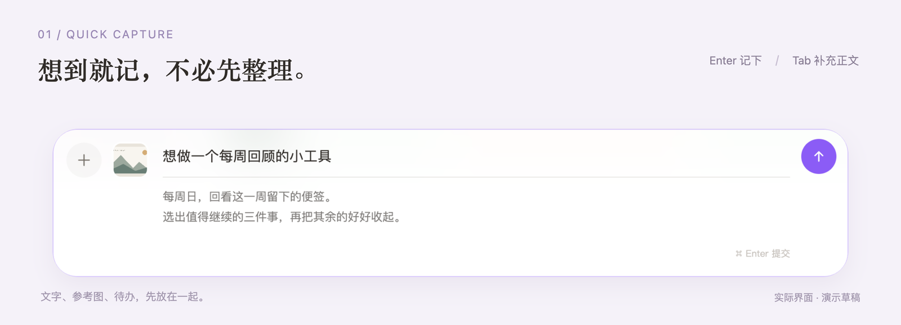
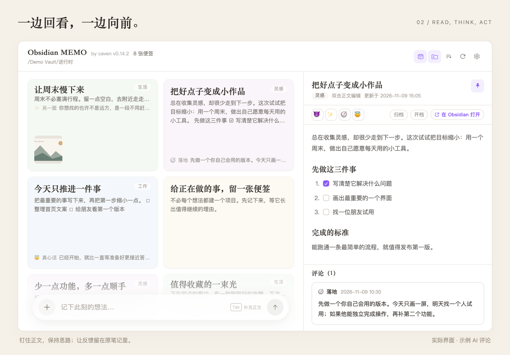

# dsh-obsidian-memo

**DeepSeek Harness 的 Obsidian 便签插件。**

在 Harness 里随手记录、回看灵感，让 AI 把想法推进一步。笔记始终保存在你的 Obsidian 仓库里，是普通的 Markdown 文件。

Harness 侧栏入口 · 本地 Markdown · 复用默认模型 · 一键开档

[它是什么](#它是什么) · [安装](#安装) · [用法](#用法) · [数据与隐私](#数据与隐私) · [常见问题](#常见问题) · [English](README.en.md)

 [](LICENSE)  [](https://github.com/cavenzhong/dsh-obsidian-memo/stargazers)

## 它是什么

在 DeepSeek Harness 里与 AI 一起工作时，总有些想法值得记下，却还没到需要建项目的程度。

dsh-obsidian-memo 在 Harness 左侧栏提供便签入口，把 Obsidian 文件夹摊开成一面淡色便签墙。随想、参考图、正在推进的小事，都能在工作间隙随手记录；需要反馈时，直接用 Harness 的默认模型换个角度想。

**记下 → 回看 → 获得反馈 → 开成项目 / 收好归档**

它不另建笔记库，也不把内容锁在插件里：便签就是你所选 Obsidian 目录中的 `.md`，图片是仓库里的附件，归档就是移动文件。

**适合**

- 笔记已经在 Obsidian 里，想在工作时随手记下新想法。
- 不想为每条灵感单独建项目，但希望需要时能一键展开。
- 愿意让 AI 参与讨论，同时希望笔记仍是本地 Markdown。

**不适合**

- 想用它替代 Obsidian 的搜索、双向链接与插件生态。
- 需要在手机上完整操作便签墙（目前侧重桌面）。

## 亮点

- **一眼看见正在想什么。** 子文件夹自动分色，按日期筛选、按创建或修改时间排序；浅色与深色主题都照顾到了。
- **想到就记，图文一起。** 底部输入栏随时记录，支持粘贴、拖入、多选图片，默认自动压缩为 WebP。
- **看与改，都在手边。** 点开卡片阅读，双击编辑 Markdown；钉住右侧面板，边看便签墙边整理，也能直接勾选待办。
- **从一句话，走到下一步。** 四种 AI 评论帮你换视角；「开档」生成结构化项目文档，并把项目链接写回原便签。
- **笔记仍归 Obsidian。** 保留原有 frontmatter，不导入、不迁移；除你主动触发的模型调用外不联网，也不为插件单独保存 API Key。

## 看一眼

### 记下：标题就是文件名



写一句标题，按 `Enter` 就是一张便签。想多写一点，按 `Tab` 展开正文，用 `⌘ / Ctrl + Enter` 提交。图片可以直接粘贴或拖进输入栏，记录时不必先整理附件。

标题就是 Markdown 文件名；正文、图片与之后的评论，都留在同一份笔记里。

### 回看：正文、任务与 AI 意见在一处



右侧面板里可以读全文、展开或折叠评论、直接勾选任务；钉住后与便签墙左右并排，边整理边对照。面板宽度可拖拽，正文与评论各自滚动。

## 安装

**需要**

- 已安装 **DeepSeek Harness** `0.2.2-rc.1` 及以上的 `0.2.x`（开发与验证于 `0.2.2-rc.1`；桌面版与 Web GUI 使用同一条通道）。
- 本机可访问的 **Obsidian 仓库**。插件直接读写这个文件夹，不需要在 Obsidian 里安装任何配套插件。
- 插件无需构建，也没有运行时依赖；不需要单独准备 Node、pnpm 或 API Key。

**1. 从 npm 安装**

在 DSH「插件」页点「添加插件」并输入 `dsh-obsidian-memo`。也可以在 Harness 对话中让 agent 调用 `plugin_manager`：

```text
action: install_bundle
target: dsh-obsidian-memo
```

安装后打开 Harness 左侧栏的便签入口。如果之前用 `link:` 装过本地目录版本，先在插件页移除旧条目再安装本包；npm 上的 `dsh-sticky-notes` 是其他人的插件，与本项目无关。

**本地开发**

```bash
git clone https://github.com/cavenzhong/dsh-obsidian-memo.git
```

在 Harness 对话中调用 `plugin_manager` 并使用 `target: link:/absolute/path/to/dsh-obsidian-memo`。`link:` 安装引用本地目录，适合开发和预览，不提供 npm 版本检查。

**2. 选好目录，开始记录**

点右上角齿轮，或到官方「设置 → 插件 → Obsidian MEMO」。先选仓库和便签文件夹；其余文件夹只显示仓库相对路径，共用支持新建、系统选择、搜索和最近记录的下拉菜单。设置分为「文件夹 / AI / 图片 / 管理与关于」，AI 角色通过横向 Emoji 标签切换，末尾加号添加角色。

| 设置 | 必填 | 说明 |
| --- | --- | --- |
| 仓库根目录 | 是 | 你的 Obsidian vault，例如 `~/Documents/MyVault`。 |
| 便签目录 | 是 | 仓库内想常常回看的文件夹，例如 `Inbox` 或 `进行时`。 |
| 开档目录 | 开档时 | 仓库内存放项目文档的位置。 |
| 归档目录 | 否 | 可加多个，归档按钮会列出这些目标。 |
| 图片文件夹 | 否 | 留空时使用便签目录的 `_attachments/`；必须在仓库内，且不能是以 `.` 开头的隐藏目录。 |
| 图片处理 | 否 | 默认开启 WebP 压缩：质量 70、最大边长 2048px，可调整或关闭。 |
| AI 预设与预算 | 否 | 四种评论角色、提示词、callout 样式与生成预算；默认「高」。 |

目录都需位于同一个 Obsidian 仓库内。默认包含便签目录的子文件夹，可在顶栏切换。

**更新、停用与卸载**

配置默认保存在 `~/.config/dsh-obsidian-memo/config.json`（Windows 为 `%APPDATA%/dsh-obsidian-memo/config.json`；支持 `XDG_CONFIG_HOME`）。首次运行自动迁移旧 `data/settings.json` 并保留原文件。「加载配置」直接弹出系统 JSON 文件选择窗，选中即加载，取消则保留当前配置。「打开配置 / 加载配置 / 更多」按钮等宽；「更多」收纳打开文件、重新加载与另存并使用。管理页底部以一行淡色小字显示 GitHub 文字链接与 `by cavenzhong`；外部编辑自动加载，损坏文件不会被覆盖。`DSH_STICKY_NOTES_SETTINGS` 仍可固定配置位置。

- **更新**：npm 安装的插件可在 DSH「插件」页查看版本并执行更新；管理器根据 npm 包版本检查更新。`link:` 安装请 `git pull` 后重新执行本地安装命令。
- **停用**：在插件页关闭开关即可，笔记与设置都不受影响。
- **卸载**：在插件页移除插件。`link:` 安装时源码目录不会被删除，独立用户配置仍保留，可从「管理与关于」查看位置并手动清理；**Obsidian 里的笔记和附件不会被删除**。

## 用法

### 快速记录

底部胶囊浮在便签墙下方，标题自动折行显示全文。输入想法作为新 `.md` 的文件名，按 `Enter` 创建；标题不会重复写进正文。按 `Tab` 展开正文区，空正文在失焦或按 Backspace 后收起；提交失败（重名、文件名过长等）会保留草稿与图片。

图片可以粘贴、拖入或点左侧加号多选，最多 8 张；默认压缩成静态 WebP，原始格式与动图可在设置里选择保留。新建时会沿用 Obsidian 为当前文件夹配置的 Default Template 的 frontmatter。

### 阅读、编辑与整理

- 单击卡片从右侧打开阅读面板；双击标题或正文进入编辑，`⌘ / Ctrl + S` 保存。
- 便签保持普通箭头光标；文件夹标签叠在右上方，使用同纸色渐变蒙层。卡片与阅读面板共用同纸色标签和对应深色文字，深色主题自动调整对比度。
- 阅读面板操作条一行放完：左侧「归档 / 到项目 / 删除 / 复制全文」四个线图标，悬停或聚焦显示上方提示；右侧保留紫色图标与文字的「在 Obsidian 打开」。AI 评论 emoji 移到底部评论区的标题行（与「评论（N）」同一行、靠右）。仅空正文显示「双击正文编辑」。
- 编辑保存带打开时的内容版本；期间若被 Obsidian、AI 评论或其他编辑改动过，会拒绝覆盖并保留草稿。
- 阅读模式可直接勾选任务，写回原 Markdown 的 `[ ]` / `[x]`，保留换行与 frontmatter。
- 点图钉把面板固定在右侧；再次进入会恢复上次打开的便签。
- 顶栏可切换日期范围、是否包含子文件夹、排序（创建时间 / 最近修改 / 文件名）。

### 四种 AI 视角

点卡片上的 emoji，调用 Harness 当前默认模型，针对这张便签给出反馈。提示词、评论样式和生成预算都可自定义。

| 视角 | 你会得到什么 |
| --- | --- |
| 😈 毒舌 | 戳破自我说服，来一句有用的清醒话。 |
| ✨ 另一面 | 从一个没想过的角度，重新看这件事。 |
| 🧭 落地 | 判断、依据，以及最省力的下一步。 |
| 😇 真心话 | 接住当下的状态，给一点不带压力的鼓励。 |

反馈以 Obsidian callout 追加到原 Markdown 末尾，回到 Obsidian 仍然能读。同一个 emoji 已有评论时，会先确认是否再生成一条。

### 整理、复制与删除

拖拽缩略卡片带柔和阴影，动作提示在其上方居中。归档目录菜单固定在底部归档区上方并带淡阴影；在归档主区放手后，预览停在该区中心，图标与文字暂时隐藏。点击目录完成归档；点击外部、焦点移出、窗口失焦或 Esc 回到原位，Enter 则回落后进入输入岛。

拖动卡片时，输入岛切换为「归档 / 到项目 / 删除」操作栏；拖到归档时可继续选择已配置的归档目录，拖到项目会打开项目名确认框，拖到删除即执行。原位置保留空虚线框，跟随光标的卡片宽高缩为原来的 1/3，实色动作提示固定在预览上方且层级更高；底部渐变按操作变色，操作栏避开右侧面板。卡片菜单的 AI 评论区下方仅保留「复制 / 在 Obsidian 打开」。
拖动只更新跟随浮层；输入岛与操作栏切换保持布局稳定。取消放手时短动画回落，归档或删除时淡出，操作完成后再清理占位，避免原卡片闪回。系统开启减弱动态效果时直接完成动画。

- **复制**：卡片底部或阅读面板的复制按钮将标题单独一行、换行后完整 Markdown 正文复制到剪贴板，成功显示提示。
- **删除**：阅读面板点浅警示色删除图标、拖到删除区，或在卡片/阅读面板按 `⌘ / Ctrl + Backspace`。Markdown 与独占本地图片成组进入笔记库内的 `.trash/MEMO-…` 文件夹，5 秒内可撤回；共享图片保留，避免影响其他笔记。过期后保留文件，不自动清空，可按组内 `restore.json` 的原路径手动移回。使用已有的 `.trash` 时不会清理其他回收文件。设置里的「管理与关于」另有 Finder 入口与「移至系统垃圾桶」：确认后将整个仓库 .trash 移到系统垃圾桶，包括 Obsidian 回收的内容；之后从系统垃圾桶恢复，不会清空系统已有垃圾。macOS Finder 可按 `⌘ + Shift + .` 显示隐藏文件夹。
- **返回顶部**：向下滚动超过一屏后，输入岛上方出现圆形 ↑ 按钮。

### 到项目、归档、在 Obsidian 打开

- **到项目**：从阅读面板或拖拽菜单进入；输入项目名后，AI 在开档目录生成 `<项目名>/<项目名>.md`，整理诉求、现状与已知、调查与线索、下一步、待确认事项，并把链接写回源便签的 `PROJECTS` 字段。
- **归档**：把 Markdown 文件移动到所选归档目录；顶部浮窗 6 秒内可撤销。
- **在 Obsidian 打开**：由 Host 调用系统打开器打开 `obsidian://open?path=<便签绝对路径>`；只对仓库内已存在的文件生效，不会写入任何内容。

### 常用快捷键

| 操作 | 快捷键 |
| --- | --- |
| 新建便签 | 标题输入框内按 `Enter` |
| 聚焦输入岛 / 退出焦点 | `Enter`（输入岛内输入、右侧正文编辑除外）/ 岛内 `Esc` |
| 展开 / 收起正文 | 标题内 `Tab` / 空正文 `Backspace` 或失焦 |
| 删除便签 | 卡片或阅读面板 `⌘ / Ctrl + Backspace` |
| 提交便签 | `⌘ / Ctrl + Enter` |
| 从正文回到标题 | `Shift + Tab` |
| 保存编辑 | `⌘ / Ctrl + S` |
| 阅读 / 编辑 | 单击卡片 / 双击标题或正文 |
| 打开日期范围菜单 | 悬停日历图标，或聚焦后按 `↓` |
| 关闭菜单 / 面板 | `Esc` |

## 数据与隐私

- **笔记与图片都在你的仓库里，删除后保留在库内 `.trash` 回收站。** 插件直接读写你选定的 Obsidian 目录，不导入、不复制到别处，也不维护第二套笔记库。
- **设置保存在独立用户配置目录的 `config.json`，也可自定义位置。** 官方设置页与面板共用该文件，不往 Obsidian 仓库里放配置文件。
- **不为插件单独配置 API Key。** AI 复用 Harness 当前默认模型；只有你主动点评论或开档时才调用，不新开会话、不写对话记录。
- **除模型调用外不主动外联。** 没有遥测或统计上报；笔记里的网络图片由浏览器按需加载，这是普通 Markdown 的行为。
- **模型调用会把相关笔记内容发给所配置的模型服务。** 这是生成评论与项目文档的必要输入，内容范围限于当前便签。
- **文件边界有校验。** 便签、归档、开档与图片路径都必须落在仓库内；图片文件夹不能指向隐藏目录；已有文件采用原子写入，新建便签拒绝覆盖同名文件。
- **frontmatter 原样保留。** 只有「开档写回 PROJECTS」会改动 frontmatter，且已有非空关联不会被覆盖。
- **与 Obsidian 并发编辑时以版本检查兜底。** 没有跨进程文件锁；在版本检查与写盘之间的极短窗口里，外部写入仍可能竞争。

## 兼容性与边界

| 项 | 说明 |
| --- | --- |
| DeepSeek Harness | 要求 `>=0.2.2-rc.1 <0.3.0`（`engines.dsh`）；开发与验证于 0.2.2-rc.1。 |
| 运行环境 | DSH 桌面版或 Web GUI；macOS 已验证，Windows / Linux 的路径与打开逻辑已实现但未实测。 |
| Obsidian | 本地 vault，可位于 iCloud；不需要安装 Obsidian 社区插件。 |
| 主题 | 跟随 DSH 浅色 / 深色主题。 |
| 规模 | 便签墙首屏 50 张，滚到底自动补批；数百张仍可用。 |
| 不提供 | 全文搜索、拖拽排序、批量操作、移动端专门适配、文件实时监听（以 4–30 秒轮询感知外部修改）。 |

- 本地图片支持 PNG / JPEG / GIF / WebP / SVG / AVIF，单张原文不超过 8 MB；卡片缩略图只加载 ≤1.5 MB 的图片（更大的进阅读模式仍可查看）。
- 快速记录最多 8 张图；压缩前单张 ≤32 MB、合计 ≤64 MB，压缩后单张 ≤8 MB、合计 ≤16 MB。
- AI 输入正文上限 12000 字符，评论输出上限 4000 字符，开档输出上限 24000 字符；发生裁切会提示。
- 目前侧重桌面使用；移动端没有专门适配，触摸设备上的日期范围菜单也有限制。

## 常见问题

**侧栏里找不到便签入口？**

先确认插件已安装并启用，然后重启或刷新 DSH。仍不出现时，检查是否还装着旧包名的版本（`dsh-sticky-notes`）——先移除旧包，再安装本包。

**面板打开了，但便签墙是空的？**

依次检查：设置里的「仓库根目录」「便签目录」是否指向真实存在的目录；日期筛选是否点亮且范围里没有笔记（点日历图标可关闭筛选）；子文件夹开关是否关掉了；目录里是否确实有 `.md` 文件。

**AI 评论没有写出来？**

先确认 DSH 已配置默认模型。模型把输出预算都花在思考上时可能没有正文，插件会提示并引导去设置提高预算；也可以换一个更短的提示词再试。网络或模型服务错误会在 toast 里给出原因。

**提示文件名重复或保存失败？**

标题就是 Markdown 文件名，同一目录下不能重名。换一个标题，或先处理已有文件；失败时草稿和已选图片会保留，成功后才清空。

**「在 Obsidian 打开」没有反应？**

需要本机安装 Obsidian 并注册 `obsidian://` 协议；只对仓库内已存在的文件生效。未安装、协议未注册或文件不在仓库内时，会给出失败提示，不会修改任何文件。

**会在 Obsidian 里改坏我的笔记吗？**

不会写入 frontmatter 以外的结构改动：正文编辑只替换 frontmatter 之后的正文，评论追加在文末，开档只更新 `PROJECTS`。行尾 block id 只在插件里隐藏显示，原文件不改。若外部同时修改，保存会因版本不符被拒绝。

**卸载会删掉我的笔记吗？**

不会。笔记和附件始终在 Obsidian 仓库里。卸载只移除插件注册；`link:` 安装的源码目录、独立用户配置文件和迁移前的 `data/settings.json` 都会保留，可手动清理。

**这是官方的 Obsidian 插件吗？**

不是。它是 DeepSeek Harness 的第三方社区插件，不隶属 DeepSeek 或 Obsidian，也不需要安装 Obsidian 社区插件；只读写你指定的本地仓库。

## 反馈与贡献

- 遇到问题或想改行为，欢迎提 [Issue](https://github.com/cavenzhong/dsh-obsidian-memo/issues)。请附上 DSH 版本、插件版本、操作系统、Obsidian 版本、复现步骤、期望结果与实际结果；有截图或日志更好。
- 也欢迎直接提 PR。插件是原生 JavaScript、零运行时依赖；前端源码按模块维护，修改后运行 `pnpm build` 和 `pnpm test`，并在 PR 里说明测试结果。
- 已知问题与暂缓项记录在 [docs/KNOWN_ISSUES.md](docs/KNOWN_ISSUES.md)，提交前可以先搜一下是否已经涵盖。

## 开发

```bash
cd dsh-obsidian-memo
pnpm install --frozen-lockfile
pnpm build       # src/client/ → lib/client.js
pnpm test        # 构建一致性 + 架构边界 + 单元与集成回归
pnpm dev         # 可选：持续构建前端，配合 Harness HMR
```

发布时更新 `package.json` 的版本号和中英文 README 标记，并在 `docs/CHANGELOG.md` 添加对应记录，再推送到 `main`。GitHub Actions 会测试并打出单一 `.tgz`，将同一文件发布到 npm（[`dsh-obsidian-memo`](https://www.npmjs.com/package/dsh-obsidian-memo)）并作为 GitHub Release 附件；npm 包包含运行文件、前端源码与构建脚本、locale、bundle patch 和文档，不包含测试或内部指引。npm 侧使用 Trusted Publishing（OIDC，不保存长期 token），已通过 `npm trust github --file release.yml --repo cavenzhong/dsh-obsidian-memo --allow-publish` 绑定 GitHub Actions；若绑定被撤销或过期，重新执行该命令（需账号 2FA）并在 48 小时内推送新版本完成验证。若 npm 版本或 GitHub Release 已存在，工作流会分别跳过对应发布，失败后可重跑；普通提交不新增 Release。

| 目录 | 内容 |
| --- | --- |
| `lib/index.js` / `lib/host/` | Host 入口与按职责拆分的业务服务、RPC。 |
| `src/client/` | 浏览器源码：按数据、便签墙、阅读、设置、图片、拖拽等功能组织。 |
| `lib/client.js` | 自动生成的浏览器发布文件；安装时无需构建。 |
| `lib/capture.js` / `lib/notes.js` | 新建便签与附件、Markdown 解析与写入。 |
| `lib/settings.js` / `lib/scan.js` | 设置读写、目录扫描与缓存。 |
| `lib/ai.js` / `lib/obsidian.js` | 模型调用、系统打开器。 |
| `test/` / `test-support/` | 按功能拆分的测试与共享运行器。 |
| `docs/` | 使用与开发指南、实现契约、版本记录、已知问题。 |

0.16.3 将 Host 服务、浏览器交互和大型测试按职责拆分。开发或让 AI agent 接手时，先看 [架构导航](docs/ARCHITECTURE.md) 与 [仓库开发指引](https://github.com/cavenzhong/dsh-obsidian-memo/blob/main/AGENTS.md)，按功能定位源码和测试；0.16 的性能复核记录保留在 [排查报告](docs/AUDIT-0.16.md)。

更完整的操作说明、文件行为与 HMR 开发方式见 [使用与开发指南](docs/GUIDE.md)；接口与 UX 规格见 [实现契约](docs/CONTRACT.md)。

## 致谢与许可

谢谢 [DeepSeek Harness](https://github.com/deepseek-ai/deepseek-harness) 开放的插件接口，也谢谢 [Obsidian](https://obsidian.md) 让笔记可以只是本地 Markdown。

本项目以 [MIT](LICENSE) 许可发布，© cavenzhong。它是第三方插件，与 DeepSeek、Obsidian 无隶属关系；相关名称与标识归各自所有者。
