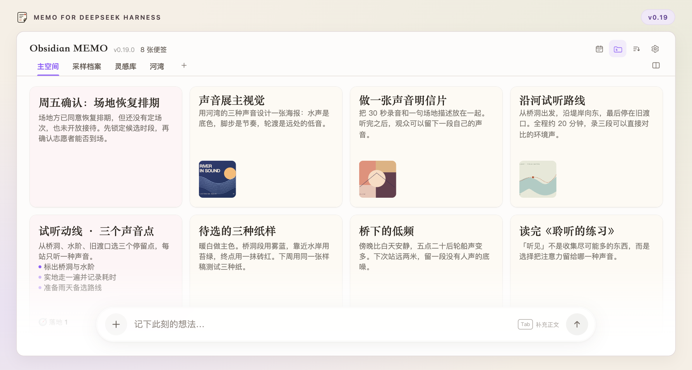
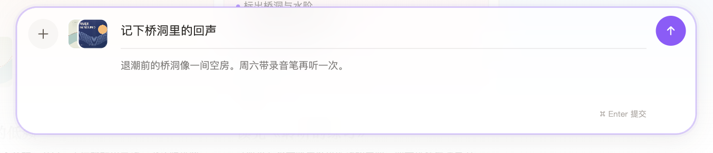
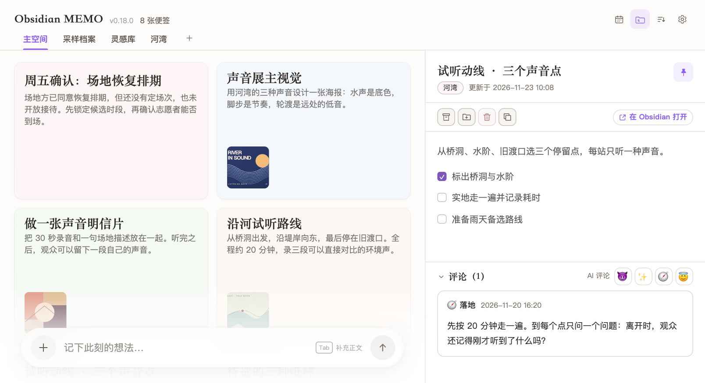
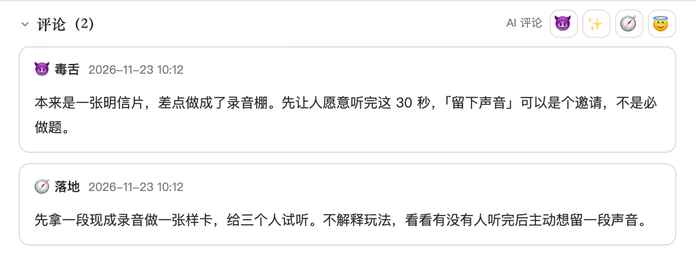
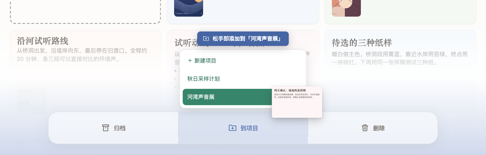
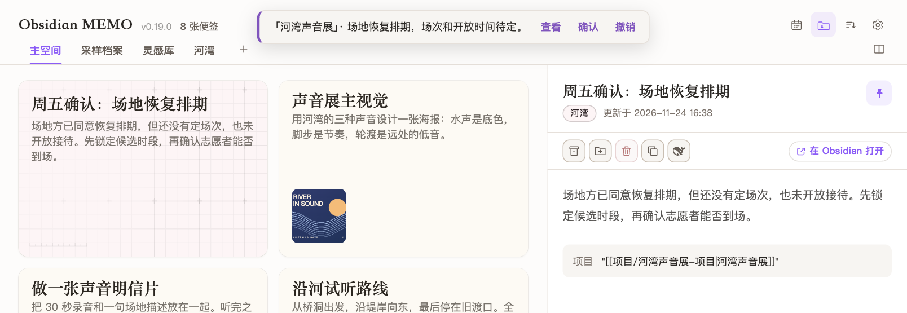

<p align="center">
  
</p>

<h1 align="center">DSH Obsidian MEMO</h1>

<p align="center"><strong>在 DeepSeek Harness 里，用便签墙读写 Obsidian 笔记。</strong></p>

<p align="center">在 Harness 随手记、贴图、请 AI 点评；回 Obsidian 接着整理。<br>两边读写的是同一份本地 Markdown，不用导入，也不用迁移。</p>

<p align="center">
  
  <a href="https://www.npmjs.com/package/dsh-obsidian-memo"></a>
  <a href="LICENSE"></a>
</p>

<p align="center">
  <a href="#安装"><ins>安装</ins></a> ·
  <a href="#日常用法"><ins>日常用法</ins></a> ·
  <a href="#ai-评论四种视角"><ins>AI 评论</ins></a> ·
  <a href="#把便签变成项目"><ins>把便签变成项目</ins></a> ·
  <a href="#常见问题"><ins>常见问题</ins></a> ·
  <a href="README.en.md"><ins>English</ins></a>
</p>



## 安装

需要 **DeepSeek Harness 0.2.2-rc.1 或更高的 0.2.x 版本**，以及 Harness 能访问的本地 Obsidian 仓库。不用在 Obsidian 里另装插件。

1. 在 Harness 的 **插件 → 添加插件** 中输入 `dsh-obsidian-memo`，安装并启用；装完在插件页确认版本为 **0.18.0** 或更高。
2. 如果 DSH 提示需要重启，重启一次；然后打开左侧栏的便签入口，点右上角 **设置 → 文件夹**，选择 **Obsidian 仓库** 和 **默认工作空间**（主空间）。
3. 在底部写一句，按 `Enter` 存下第一张便签。想用项目跟踪？再选一个 **项目索引目录**。

也可以在对话里让 agent 安装：

```text
action: install_bundle
target: dsh-obsidian-memo
```

npm 上的 `dsh-sticky-notes` 是另一款 DSH 便签插件，与本项目无关。更新和卸载都在插件页完成，卸载只移除插件注册，不会删除你的笔记。

## 日常用法

### 想到就记，直接贴图

底部输入栏里，`Enter` 存标题，`Tab` 展开正文，`⌘ / Ctrl + Enter` 提交图文。图片可以直接粘贴或拖进去，默认压缩成 WebP。



### 左边看全局，右边处理一张

便签墙按子文件夹分色，可按日期筛选。点开卡片、钉住右侧面板，就能一边浏览一边勾待办；双击标题或正文可编辑。也可以拖去归档，或点 **在 Obsidian 打开** 接着写。



### 工作空间：按文件夹切视图

顶栏第二行是工作空间标签。第一个「主空间」就是设置里的**默认工作空间**；点右侧 **＋**，可以把仓库内任意可见文件夹挂成标签，点进去就只看到该文件夹（含子文件夹）的便签。挂载的文件夹都会被扫描，未挂载的目录不会出现在墙上。

- **范围**：主空间展示默认工作空间；自定义标签可以是仓库里任意可见目录，甚至在默认工作空间之外或它的父级。
- **添加 / 删除**：加号复用设置里的文件夹选择器（搜索、最近、新建、系统选择）。右键标签可删除；删除只移除标签，不动文件夹，5 秒内可撤销。
- **排序**：「主空间」固定在最前；长按其他标签约 0.4 秒后可拖动排序，短按仍是切换。
- **颜色**：右键自定义标签可给这个空间选纸色（8 个预设，默认随机）；空间内所有卡片会统一换成该纸色，主空间仍按文件夹配色。
- **迁移**：把卡片拖到任意标签上，松手就把这张便签移进该目录（同名自动加序号），完成后可在提示里撤销。默认工作空间之外的标签同样接收便签。
- **新建**：在某个工作空间里快速记录，新便签直接落在该目录。

## AI 评论：四种视角

不用把笔记复制到聊天里。打开便签，在评论区点一个 emoji，AI 就会从那个角度留一条评论。评论会追加到原笔记末尾，回 Obsidian 也能看到。

| 视角 | 适合什么时候用 |
| --- | --- |
| 😈 **毒舌** | 想听一句不拐弯的，用幽默点破盲点。 |
| ✨ **另一面** | 思路卡住时，从没想过的人或场景看这件事。 |
| 🧭 **落地** | 想知道先做什么，拿到一个可验证的下一步。 |
| 😇 **真心话** | 想要一点支持，看看自己已经做对了什么。 |



*同一个「声音明信片」点子：毒舌提醒别把它做复杂，落地建议先找三个人试听。*

四个预设都可以在 **设置 → AI** 里自定义。

## 把便签变成项目

拖一张便签到 **「到项目」**，可以新建项目，也可以补充到已有项目。源便签留在原处，只多一条指向项目的 Obsidian 双链。



*拖到「到项目」会列出新建和已有项目；补充默认等 3 秒，可取消。*

每次补充，AI 更新 **当前概况**，并在 **进展记录** 末尾追加一条。先看概况就知道现在到哪一步，想追溯再翻历史。旧记录和「我的手记」之类的独立二级章节原样保留。



*写入后先看变更摘要；不合适可以在确认前撤销，项目和源便签一起还原。重启 Harness 后不能再撤销这次更新。*

[看看项目文档示例](docs/GUIDE.md#项目文档怎么读怎么补充)。


## 常见问题

**看不到入口，或便签墙是空的？** 先确认插件已启用，必要时按提示重启 DSH——桌面版通常要重启一次才会出现侧栏入口。墙面为空时，检查默认工作空间里是否有 `.md` 文件，试着关掉日期筛选；如果笔记都在子文件夹里，打开子文件夹开关。想让别的仓库目录也出现在墙上，点「＋」把它挂成工作空间。

**AI 要另配 Key 吗？没生成怎么办？** 不用另配。评论用 Harness 的默认模型，项目可以在 **设置 → AI → 项目 AI** 单独选模型。没生成时，先检查模型配置，再按面板提示重试或调整预算。

**更新、卸载会动我的笔记吗？** 更新在插件页按 npm 版本进行；卸载只移除插件注册，笔记和附件留在仓库里。

**支持哪些系统？** 主要在 macOS 上开发验证；Windows / Linux 的路径与「在 Obsidian 打开」已实现但未实测，移动端没有专门适配，以桌面为主。

**笔记会上传吗？** 笔记和附件留在本地仓库，插件没有遥测。只有你主动使用 AI 评论或项目功能时，相关便签及所需的项目内容才会发给配置的模型服务。

**误删便签怎么办？** 便签移入仓库内的 `.trash`，不是直接永久删除。删除后可以在提示消失前撤回；错过了也可以从库内回收站找回。

**工作空间会同步到别的设备吗？** 不会。标签列表是当前 Harness 配置里的视图偏好（按仓库路径保存在本地），不写进 Obsidian 仓库，也不进设置 JSON；换设备或清理浏览器数据后重新添加即可，笔记本身不受影响。

---

[详细指南](docs/GUIDE.md) · [版本记录](docs/CHANGELOG.md) · [开发导航](docs/ARCHITECTURE.md) · [已知问题](docs/KNOWN_ISSUES.md) · [反馈问题](https://github.com/cavenzhong/dsh-obsidian-memo/issues) · [MIT 许可](LICENSE)
